<div align="center">

# Emmanuel Wilson

### He isn't a 3D model

A portfolio told as one scroll through a 3D studio, led by a character who watches your cursor. He is 55 video frames, a handful of short clips and a little trigonometry.

**[emmanuelwilson.tech](https://emmanuelwilson.tech)**


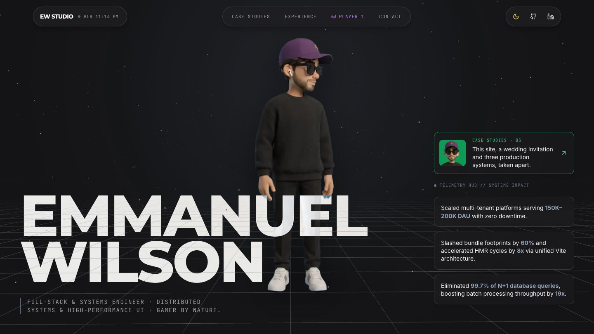

</div>

## The idea

Most portfolios are a stack of sections. This one is a single studio you travel through. A fixed WebGL stage sits behind the whole site, and scrolling flies its camera from one stop to the next: a ring of frames, a green-screen wall, two rivers, a skyline. The content floats over it as glass cards.

The guide is a character. He idles, breathes, and turns to follow the pointer, and at each chapter he plays a short clip that suits it. There is no rig and no mesh: every pose is a real frame of video, keyed off a green wall.

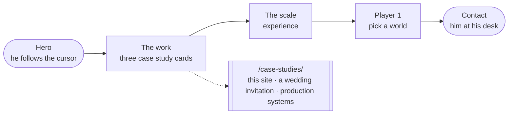

## A walk through

| | |
|:--|:--|
| 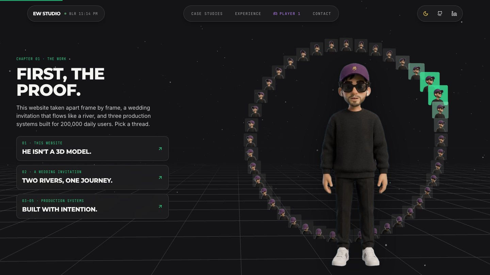 | 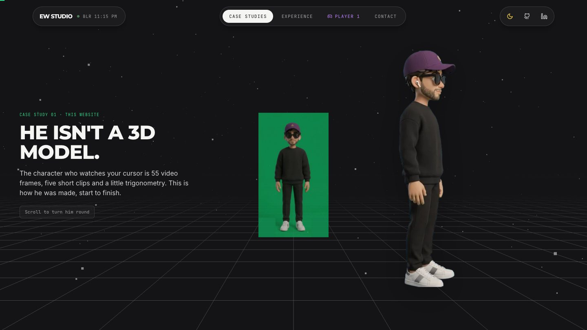 |
| **First, the proof.** He stands inside the ring of his own frames. The cursor's angle picks one, and hovering a card swaps him for a glimpse of that case study. | **He isn't a 3D model.** The first case study is this site. He turns all the way round as you scroll: 48 frames stepped by scroll position. |
| 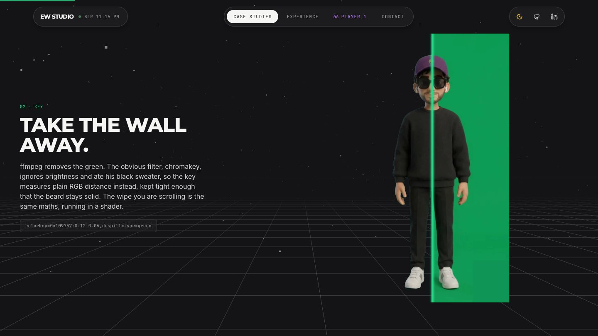 | 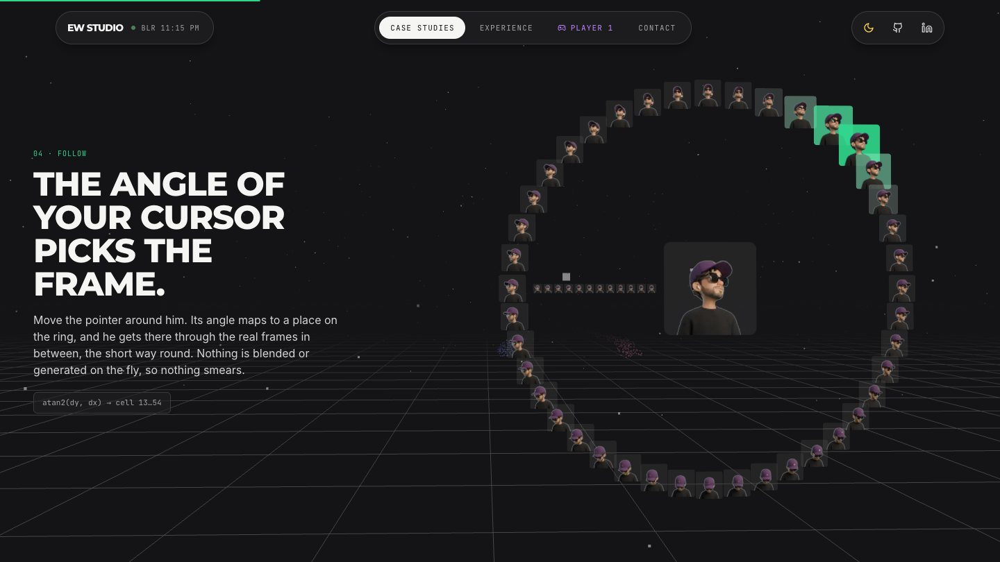 |
| **Take the wall away.** Scrolling wipes the green off one source frame, live, in a fragment shader that runs the same maths as the ffmpeg key. | **The angle of your cursor picks the frame.** The mechanism laid out flat: 42 poses round the ring, 12 on the spoke from the camera, one facing you. |
| 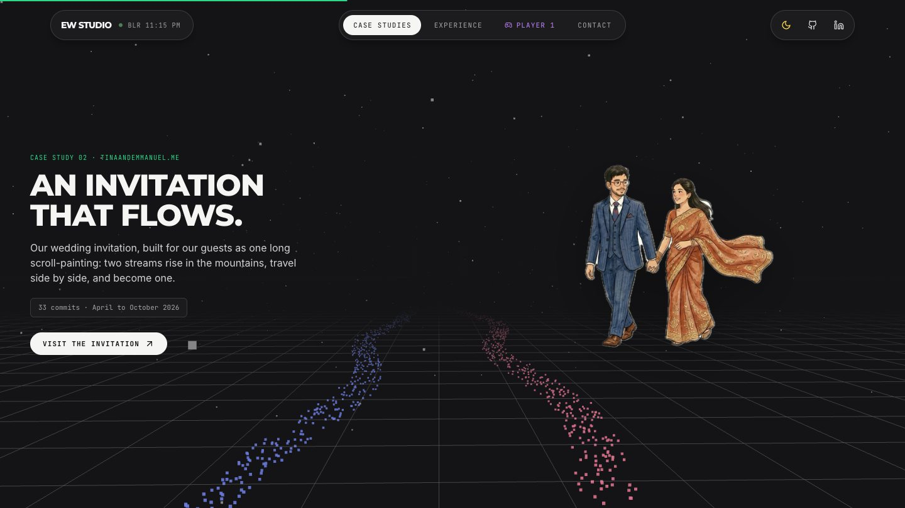 | 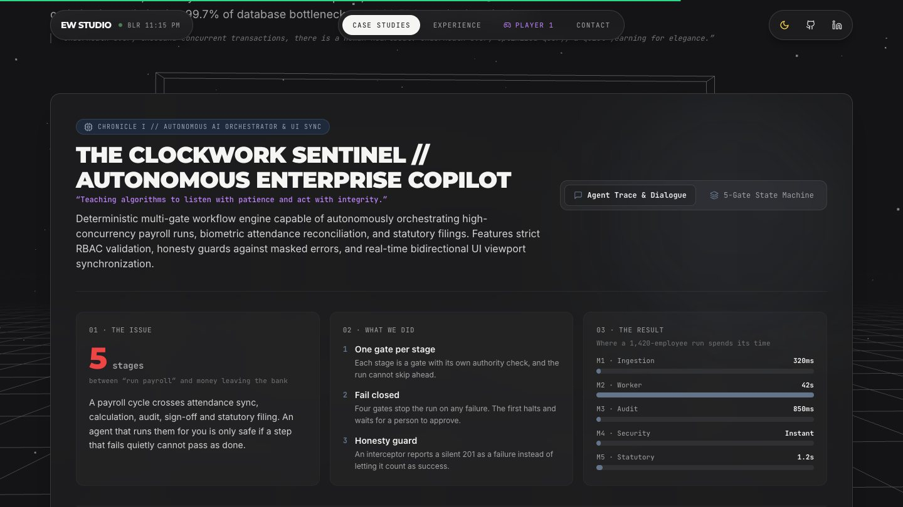 |
| **An invitation that flows.** The second case study, [a wedding invitation](https://github.com/emwil23/weddingvibes): two streams of particles run side by side and become one. | **Now the day job.** Three production systems, each with an issue, what was done, and the result, plus the simulations that go with them. |
| 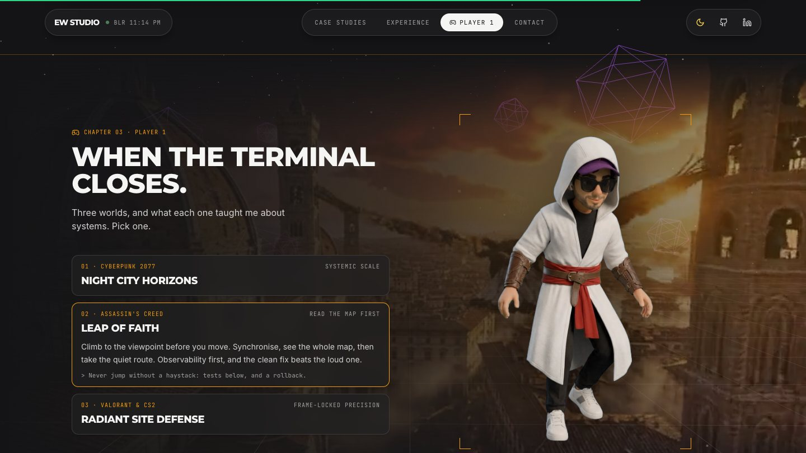 | 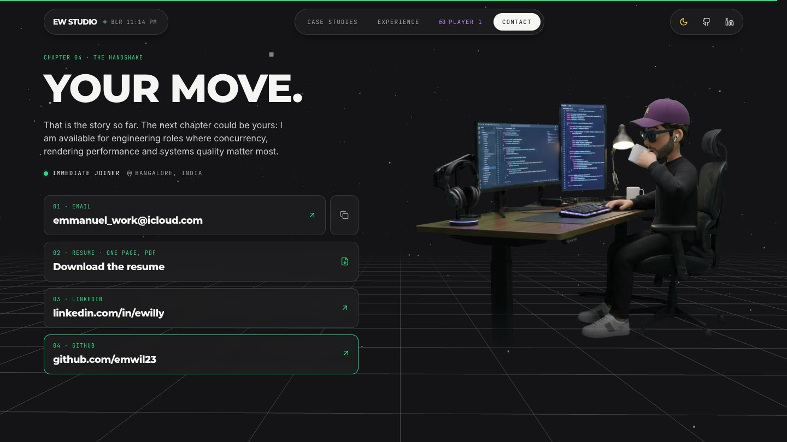 |
| **Player 1.** Pick a world and he changes kit, the backdrop fades in, and the screen takes that world's colour. | **Your move.** Four ways to reach him, and a looping clip of him at work. |

## How it is built

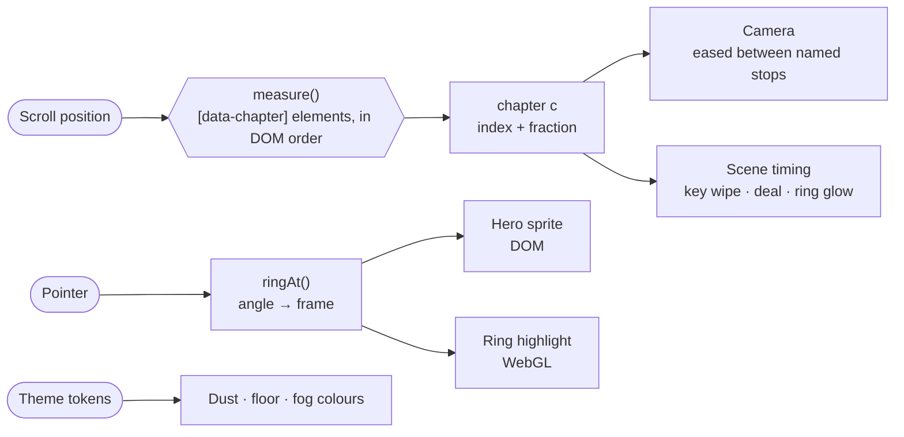

One `requestAnimationFrame` loop owns the stage. Each frame it works out which chapter is at the middle of the screen as a number, such as `2.4`, and everything else is a function of that number: where the camera is, how far the green wall has been wiped, how far the frames have been dealt. Nothing in that path goes through React state.

**Chapters name their own camera stop.** Every story beat is an element with `data-chapter="<scene>"`. The stage reads them in DOM order and looks each scene up in a table of stops, so reordering the page reorders the flight, and the two routes share one stage with different sets.

**The character is a small state machine.**

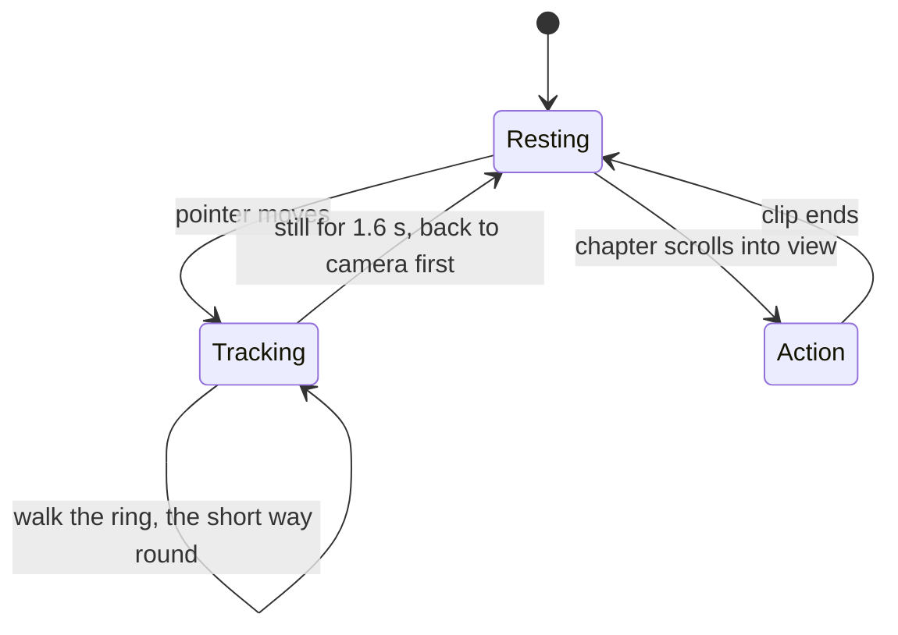

He never cuts or blends between two different poses. A change of pose is played through the real frames in between, and clips only hand over at the neutral pose they all start and end in.

**From green screen to the page**

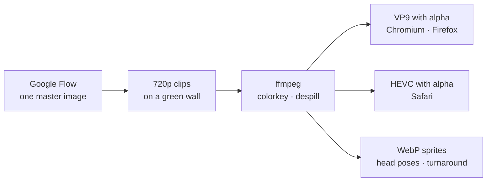

**What is drawn where**

| Layer | Technique |
|:--|:--|
| Stage | One three.js canvas, fixed behind the page: dust, a floor grid, fog, and a set-piece per scene. Loaded after first paint. |
| Ring of frames | One instanced mesh of 55 cards reading cells of a single sprite texture. The lit card gets its green wall back in the shader. |
| Green-screen wipe | A plane with the raw frame and a fragment shader doing ffmpeg's `colorkey` maths, wiped by scroll. |
| Head tracking | An 8×7 WebP sprite as a CSS background. The pointer's angle maps to a place on the ring; the right-hand turn is the left-hand one mirrored. |
| Character clips | `<video>` with two sources: VP9 with alpha, and HEVC with alpha for Safari. |
| Turnaround | An 8×6 sprite stepped by how far its chapter has scrolled. |
| Content | Ordinary DOM over the stage: glass cards with no section backgrounds, so the scene shows through. |

## Decisions worth explaining

- **Frames, not a model.** The footage is generated, so there is no rig to pose. A sprite of real frames gives a head that turns smoothly with nothing synthesised on the fly, which is why it never smears.
- **`colorkey`, not `chromakey`.** Chroma keying ignores brightness and ate his black sweater. Keying on plain RGB distance, kept tight, leaves the clothes and beard solid.
- **Every clip is measured.** Each generated clip has a slightly different wall green and framing. The keying script carries a mask, crop and key colour per clip so he never jumps or resizes when one starts.
- **Black under the alpha.** Safari's HEVC clips showed a blue halo: the keyed-out pixels still held the despilled wall, and lossy alpha let a ring of it through. Those pixels are now painted black before encoding.
- **Plain three.js, one canvas.** The scenes are points, lines, a few planes and one instanced mesh. A React scene graph would add weight and a second render loop for nothing.
- **A blend mode with a fallback.** The hero name inverts against whatever is behind it with `mix-blend-mode: difference`. Safari does not blend against the WebGL layer, so there it takes the theme's text colour with a halo instead.
- **The stage follows the theme.** Dust, floor and fog read the same CSS tokens as the page, so the light and dark themes carry into the 3D scene with no second palette.
- **Static export.** The site is plain files on GitHub Pages behind a custom domain. No server, no API.
- **Reduced motion.** With `prefers-reduced-motion`, the stage drops its parallax, drift and easing, and entrance animations are switched off.

## How it got here

| Version | Concept | Why it changed |
|:--|:--|:--|
| v1 | Flat sections with a looping character video | The character was decoration, not a guide |
| v2 | The same layout with a character clip in every section | Felt bolted on; the layout had not changed to suit him |
| **v3** | A 3D stage, story beats, and a separate case studies page | Shipped |
| v3.1 | Player 1 and Contact cut down to one or two quiet screens | Long per-item scroll beats were too much |

## How it was made

The site was built in conversation with [Claude Code](https://claude.com/claude-code), which wrote and tested the code, and the character footage was generated in Google Flow from one master image. The design direction, the content and every call on what stayed or went are mine.

## Run it

```bash
npm install
```

```bash
npm run dev
```

```bash
npm run build
```

Node 20. `npm run build` writes the static site to `out/`. Pushing to `main` deploys it through `.github/workflows/deploy.yml`. Append `?skip=true` to the URL to skip the preloader.

There is no test suite; `npx tsc --noEmit` and the build are the checks.

`scripts/key-assets.sh` rebuilds everything in `public/assets/character/` from the green-screen sources. It needs ffmpeg with `libvpx-vp9`, macOS for the HEVC step, and `cwebp`. The sources themselves are not in the repository.

## Where things are

```
app/
├─ page.tsx               the home story, in order
├─ case-studies/page.tsx  the case studies, in order
├─ layout.tsx             fonts, theme script, sharing metadata
└─ globals.css            colour tokens for both themes, a few global styles
components/
├─ Stage.tsx              the three.js stage: camera stops, set-pieces, shaders
├─ Character.tsx          idle clip, one-shot actions, cursor tracking
├─ Interlude.tsx          one story beat: a sticky screen with a camera stop
├─ Story.tsx              how the character was made
├─ WeddingStory.tsx       the wedding invitation case study
├─ CaseStudies.tsx        the production case studies and their simulations
├─ Turnaround.tsx         the scroll-driven spin
├─ Hero · Nav · Preloader
└─ ScaleLog · PlayerOne · ContactHandshake
scripts/
└─ key-assets.sh          green screen → transparent clips and sprites
```

`CLAUDE.md` has the architecture in more detail.

<div align="center">


*That is the story so far. The next chapter could be yours.*
</div>
